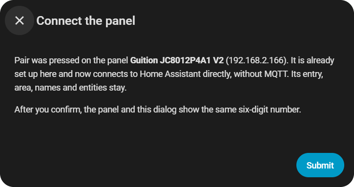

# Advanced Setup

Details for the [Installation](installer.md): manual flashing, what the display asks, setups without HACS or with an MQTT broker, and older displays.

## Manual Flashing { #manual-flashing }

If the browser installer is unavailable, use [Espressif's Flash Download Tool](https://www.espressif.com/en/support/download/other-tools) or [esptool](https://docs.espressif.com/projects/esptool/en/latest/esp32/installation.html). This alternative is for a **first installation or full reset and erases all settings**. [Export your dashboard](web-admin.md#import-export) first if needed.

1. Download the exact device's `_factory.bin` from the [latest release](https://github.com/GalusPeres/HomeTiles/releases/latest). Match the complete model and revision; V1/V2, LCD-7/LCD-7B and P4/S3 images are not interchangeable.
2. In Flash Download Tool, select **ESP32-P4** or **ESP32-S3**, **UART**, and the USB port. Erase the flash, then write the factory file at **`0x0`**. Alternatively, with esptool installed:

    ```text
    python -m esptool --port COM3 chip-id
    python -m esptool --port COM3 write-flash --erase-all 0x0 your_device_factory.bin
    ```

    Replace `COM3` with your serial port (for example `/dev/ttyACM0` on Linux), and the filename with your downloaded factory image.

3. Wait until verification finishes, then restart the display.

**ESP32-P4 revision check:** standard P4 images require pre-v3 silicon (revisions 1 to 199). The experimental Waveshare 7B and 10.1 `_rev3` images and the Guition JC8012P4A1 V3 image are for v3.1 and newer, including v3.2. Check the `chip-id` output before a manual write. esptool does not enforce HomeTiles' narrower revision checks.

Never write a plain update `.bin` at `0x0`. To preserve settings, use the browser's **Update** mode or [Firmware Updates](updating.md).


## Flashing Problems { #flashing-problems }

- **No serial port:** use a data cable, try another USB port, and close other serial monitors or flashing tools.
- **Cannot connect:** hold **BOOT** while connecting, then release it when the connection starts.
- **Wrong chip or revision:** recheck the device label and selected model; do not bypass the check.
- **Interrupted installation:** reconnect and repeat the selected operation. An interrupted Update keeps the previous app; an interrupted factory reset needs a complete factory installation.

For a blank display after flashing or connection problems after setup, see [Troubleshooting](faq.md).

## The First-Start Setup { #the-first-start-setup data-toc-label="First-start setup" }

A new display opens a setup in four steps. You can leave it at any time and finish it later under **Settings → System → Setup**.

1. **Basic settings:** language, time zone, light or dark theme, and the rotation. New ESP32-P4 displays that can stand upright also ask for landscape or upright.
2. **Connect to WiFi:** choose your network. Without a network, switch on **Hotspot** and set up the WiFi from your phone (password `12345678`).
3. **Add to Home Assistant:** tap **Pair**; the display can be found for two minutes. Home Assistant shows **Panel found**, then the same six-digit number as the display. Confirm it in Home Assistant with **Numbers match: connect** and on the display with **Confirm**.
4. **Add your tiles:** the address of the [Web Admin](web-admin.md); open it in your computer's browser.


## Pairing { #pairing }

Pairing needs no password: the display accepts it only within the two minutes after you tapped **Pair**, so only someone standing at the display can pair it. Afterwards **Settings → System** shows **Home Assistant: Connected** with **Direct · Bridge** and its address, and **Pairing: Paired**.

The display connects to Home Assistant on TCP ports `8140`–`8147`, camera tiles additionally on `8124`–`8131`. If your network separates them, allow these ports from the display to the Home Assistant host. Home Assistant finds the display by mDNS, so both need to be in the same network.

To unpair, open **Pairing** under **Settings → System → Security** on the display and tap **Unpair**, or use **Security** in the Bridge options; the other side follows. An unpaired display counts as a new display and can be paired again.

## Choosing Entities { #choosing-entities }

With a [Web Admin password](web-admin.md#web-admin-password), the entity picker of a paired display finds every entity in Home Assistant. Set it like this:

1. On the display, open **Settings → System → Security** and tap **Allow** next to **Web Admin password**.
2. Within two minutes, set the password in the Web Admin under **Settings → System**.

Without a password, the picker offers only the entities selected under **HomeTiles Bridge → Configure → Entity configuration**. For Energy tiles, also enable the electricity, gas or water category under **Configure → Energy Dashboard**.

## Security { #security }

| Protection | What it does |
| --- | --- |
| **Pairing** | Every message between display and Bridge is encrypted and signed, commands as well as states. A recorded command cannot be sent again. |
| **Web Admin password** | Only you can change the dashboard and the display's settings. |
| **Locks and alarm panels** | Work only on a paired display with a Web Admin password. Home Assistant checks their codes; see [Lock](tiles.md#lock). |
| **PINs** | Settings and folders can ask for a PIN on the display. This is a child lock, not a login. |

## Multiple Displays

Pair each display the same way. Every display becomes its own device of the HomeTiles Bridge and gets its own topic name automatically. Entity selections in the Bridge options are shared by all displays.

## Without The Button { #without-the-button data-toc-label="Without the HACS button" }

<a id="manual"></a>

**Add it to HACS by hand:** in **HACS**, open **Custom repositories** from the menu, add `https://github.com/GalusPeres/HomeTiles-Bridge` as an **Integration**, download **HomeTiles Bridge**, and restart Home Assistant.

**Without HACS:** copy `custom_components/tab5_lvgl` from the [Bridge repository](https://github.com/GalusPeres/HomeTiles-Bridge) into Home Assistant's `custom_components` directory and restart.

## Moving From MQTT To The Direct Link { #moving-from-mqtt-to-the-direct-link data-toc-label="From MQTT to direct" }

A display set up over MQTT with an older version keeps working after the update. To move it to the direct link:

1. Update the Bridge to v0.9.0 and the display to HomeTiles v0.9.0.
2. On the display, tap **Pair** under **Settings → System → Security**.
3. Home Assistant shows **Connect the panel** for the existing device. Select **Submit** and compare the number.

<figure class="ht-screenshot ht-popup">

<figcaption>Connect the panel</figcaption>
</figure>

The device keeps its entry, area, names and entities. The MQTT settings stay saved on the display but are no longer used. Encryption that was set up over MQTT is replaced by the pairing of the direct link.

## Using An MQTT Broker { #using-mqtt-instead data-toc-label="Using MQTT" }

The direct link needs no broker. If you prefer MQTT, for example to use the display's topics elsewhere:

1. Install an MQTT broker. On Home Assistant OS, install the **Mosquitto broker** app under **Settings → Apps**, start it, and add a Home Assistant user for it under **Settings → People → Users**. Confirm the discovered **MQTT** integration. Other installations: see the [official MQTT setup](https://www.home-assistant.io/integrations/mqtt/#setting-up-a-broker).
2. Open the display's Web Admin, go to **Settings → System → MQTT**, and enter the broker's IP address, port `1883`, username and password. With the Mosquitto app, use the Home Assistant machine's IP, not `core-mosquitto`. Keep the suggested **Device topic base** and **Home Assistant prefix**.
3. Select **Save**. Home Assistant shows **Panel discovered** under **Settings → Devices & services**; select **Add**.

Without discovery, add the panel under **Add Integration → HomeTiles Bridge** with the same topic base and prefix. Pairing always uses the direct link: tapping **Pair** moves an MQTT display to it.
