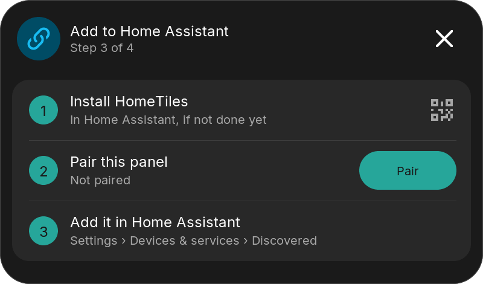
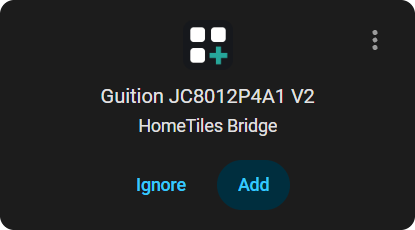
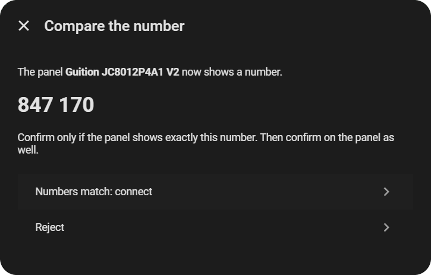
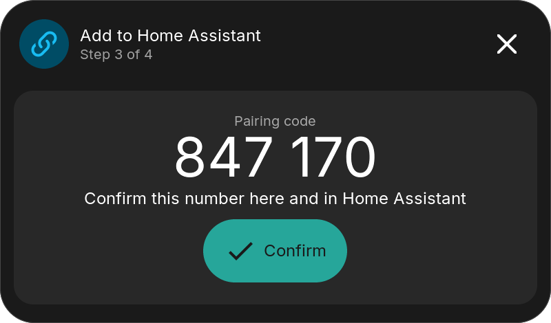
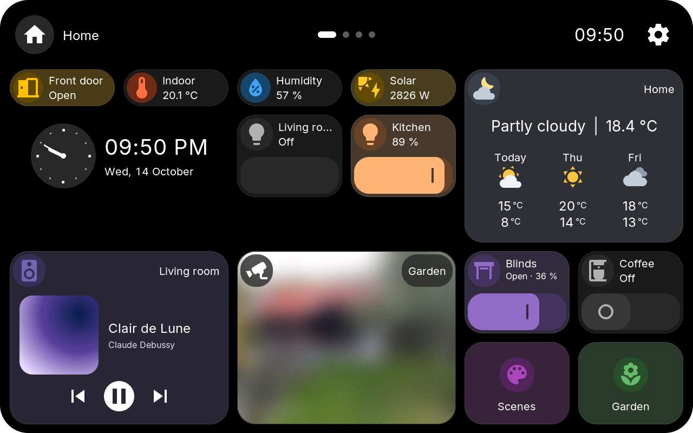

# Installation

<section class="ht-install-step" markdown>

## Flash the firmware { #browser-installer }

Connect the display by USB to a computer with Chrome or Edge and choose your [exact device](index.md#device-support).

<label class="ht-installer-section-heading" for="installer-firmware-source">Firmware</label>

Choose the published release or a local HomeTiles .bin file.

<select id="installer-firmware-source" autocomplete="off" disabled>
<option value="published">Loading published release...</option>
<option value="local">Local HomeTiles .bin file</option>
</select>
<input id="installer-firmware-file" class="ht-installer-firmware-file" type="file" accept=".bin,application/octet-stream" hidden>

<label id="installer-device-label" class="ht-installer-section-heading" for="installer-device">Device</label>

Select the exact model printed on the device or rear label.

<select id="installer-device" autocomplete="off">
<option value="">Loading devices...</option>
</select>

Mode

Update keeps settings. First install / factory reset erases all local data.

<label class="ht-installer-mode">
<input type="radio" name="installer-mode" value="update" checked>
<strong>Update</strong>
</label>
<label class="ht-installer-mode ht-installer-mode-danger">
<input type="radio" name="installer-mode" value="factory">
<strong>First install / factory reset</strong>
</label>

Check

Confirm the exact label before connecting the serial port.

<label>
<input id="installer-exact-hardware" type="checkbox">
I checked the exact model label.
</label>
<label id="installer-factory-confirmation-row" class="ht-installer-danger-check" hidden>
<input id="installer-factory-confirmation" type="checkbox">
Erase all settings and local data.
</label>

Flash

Keep power, USB and this tab open while flashing.

<button id="installer-flash" type="button" disabled>Connect and flash</button>

Loading...

Log capture is active. Selecting a port with Connect and flash stops capture and releases its USB port. Cancelling the port selection keeps capture running.

<strong id="installer-phase">Preparing</strong>
0%

<progress id="installer-progress" max="100" value="0" aria-labelledby="installer-phase installer-progress-text"></progress>

<strong>Flash log</strong>
<button id="installer-copy-log" type="button" aria-label="Copy flash log to clipboard">Copy log</button>
<button id="installer-clear-log" type="button">Clear log</button>

<pre id="installer-log-output" role="log" aria-label="Installer flash log" aria-live="off" tabindex="0"></pre>

</section>

<section class="ht-install-step" markdown>

## Install the Bridge { #install-the-bridge }

Add the [HomeTiles Bridge](https://github.com/GalusPeres/HomeTiles-Bridge) to Home Assistant with the button, select **Download** and restart Home Assistant.

</section>

<section class="ht-install-step" markdown>

## Set up the display { #set-up-the-display }

The display guides you. At **Pair**, select **Add** in Home Assistant under **Settings → Devices & services** and confirm the same number on both sides.

<figure><figcaption>1. On the display: tap <strong>Pair</strong></figcaption></figure>
<figure><figcaption>2. In Home Assistant: <strong>Add</strong></figcaption></figure>
<figure><figcaption>3. Same number: <strong>Numbers match: connect</strong></figcaption></figure>
<figure><figcaption>4. On the display: <strong>Confirm</strong></figcaption></figure>

</section>

<section class="ht-install-step" markdown>

## Add your tiles { #add-your-tiles }

Open the address the display shows in your computer's browser and build your dashboard in the [Web Admin](web-admin.md).

</section>

Manual flashing, no HACS, an MQTT broker or an older display: <a href="../advanced-setup/">Advanced setup</a>. Problems: <a href="../faq/">Troubleshooting</a>.

