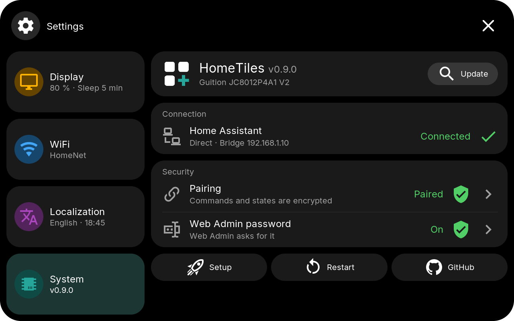
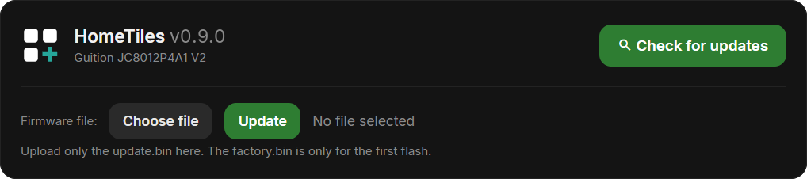

# Firmware Updates

Normal updates keep your Wi-Fi, the connection to Home Assistant and your dashboard. Keep the display powered until installation finishes, then check the version under **Settings → System**.

## On-device updater { #1-on-device-updater-recommended }

Open **Settings → System**, tap **Update**, and install the offered version. The display restarts when finished; Web Admin and the connection to Home Assistant come back automatically.

<figure class="ht-screenshot">

<figcaption>Settings → System with Update</figcaption>
</figure>

## Web Admin upload { #2-web-admin-ota-upload }

Use this method for a local test build or when downloading directly on the display fails.

1. Download the exact model's plain **`.bin`** from the [release page](https://github.com/GalusPeres/HomeTiles/releases). Do **not** select `_factory.bin`.
2. Open `http://<display-ip>/` and find **Firmware**.
3. Choose the file and start the upload. The screen may go black during installation; wait for the display to restart.

<figure class="ht-screenshot">

<figcaption>Firmware update in the Web Admin</figcaption>
</figure>

Check exact model, revision and known limitations in the [device list](index.md#device-support). The Web Admin can also run the same release check as the display.

## USB update { #3-browser-installer-over-usb }

If the display is unreachable over the network, open the [online flasher](installer.md#browser-installer) and choose **Update**. It preserves local settings and writes only to the inactive application slot.

For a new device or an intentional full reset, use **First install / factory reset** there instead. This erases all local data.

## Going back to v0.8.0 { #going-back-to-v080 data-toc-label="Downgrade to v0.8.0" }

The display only offers newer versions, but you can install v0.8.0 with the [Web Admin upload](#2-web-admin-ota-upload). v0.8.0 only knows the classic layout. Prepare the panel first:

1. **Back up:** use [Export](web-admin.md#import-export) in the Web Admin and keep the file.
2. **Switch to Classic:** click the **Layout** field in the **Global** tab, choose **Classic**, make sure no tile is red, save, and switch the panel to it. The panel now shows what v0.8.0 will show.
3. **Upload** the model's plain v0.8.0 `.bin` in the Web Admin.

Panels mounted upright show the classic landscape layout on v0.8.0. Head bar layouts, pages, the light theme and the other new settings stay stored; v0.8.0 ignores them, and they return when you update to v0.9.0 again.

v0.8.0 has no direct link to the Bridge and needs MQTT. A panel that uses the direct link needs its MQTT broker in the Web Admin again, and in Home Assistant delete its linked HomeTiles Bridge entry and add the panel again over MQTT.

## Going back to v0.6.x { data-toc-label="Downgrade to v0.6.x" }

The display only offers newer versions, but you can install an older release with the [Web Admin upload](#2-web-admin-ota-upload). v0.6.x does not know half-size tiles: a half tile appears at whole size and can overlap its neighbor. Prepare the dashboard first:

1. **Back up:** use [Export](web-admin.md#import-export) in the Web Admin and keep the file.
2. **Make every tile whole:** give every tile a whole position and size (no 0.5 values), and arrange the tiles so they do not overlap. This includes back tiles in folders, Climate tiles with a height of 1.5, and the tiles in the screensaver.
3. **Upload** the older model's plain `.bin` in the Web Admin.

Colors, rules, icon circles, the tile radius, and camera settings need no preparation. v0.6.x ignores them, and they return when you update to v0.7.0 again, as long as the tiles keep their places in between.

An export that contains half-size tiles cannot be imported in v0.6.x. Export again after step 2 if you want a file for the older version.

## If an update fails { #troubleshooting-esp32-p4c6-github-downloads }

Restart the display and retry once. If a direct GitHub download still fails, use the **Web Admin upload** above. The updater may restart more than once during recovery; check the installed version afterwards. An interrupted normal update leaves the previously selected application bootable.

If it still fails, [download the diagnostics and report the problem](faq.md#the-display-crashed-or-restarted-by-itself). For the Guition JC8012 V1 Camera/Web OTA fix, see its note in the [device list](index.md#device-support).

To build your own firmware, follow [CONTRIBUTING.md](https://github.com/GalusPeres/HomeTiles/blob/main/CONTRIBUTING.md).
